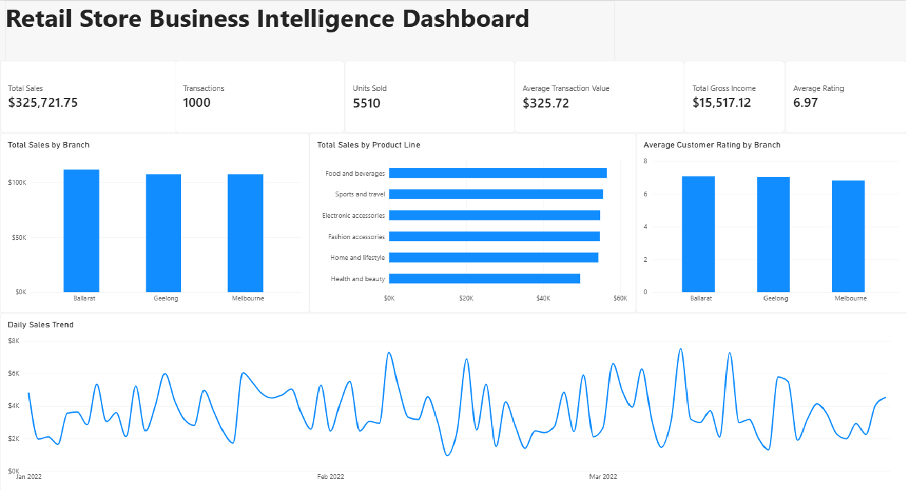

# Retail Business Intelligence and Decision Support

An academic case study using three months of transactions from a supplied three-branch retail dataset. The project examines how consistent data preparation and clear KPI reporting can support branch, product and customer decisions.

## Business questions

- How do sales and customer ratings vary by branch and product line?
- Which customer and time patterns deserve management investigation?
- What data-quality controls are needed before managers rely on a dashboard?

## Dashboard

The recorded report presents sales, transaction counts, units, average transaction value, gross income and average rating, followed by branch, product and time comparisons. These are coursework dataset results, not revenue or improvements achieved for a real client.

## Approach

The preparation work profiles the supplied workbook, preserves the source fields, handles mixed date representations and creates a transaction key where invoice identifiers repeat. Cleaned tables support a transaction-grain fact table, dimensions and an executive Power BI report. Descriptive summaries are grouped by branch, product, customer and time.

## Evidence at a glance

- 1,000 transaction records across three branches, covering January–March 2022.
- Six KPI cards covering sales including tax, transactions, units, average transaction value, gross income and customer rating.
- The recorded dashboard shows 325,721.75 in sales including tax, 5,510 units and an average customer rating of 6.97. These are dataset measures, not personal commercial achievements.
- Branch, product-line and daily-sales views connect the technical reporting work to practical commercial questions.

## What the dashboard suggests

Ballarat has the highest sales total in the saved branch comparison; food and beverages leads the product-line comparison. These observations identify areas to investigate, not explanations of what caused performance. An operational review could compare branch/product mix and the larger daily peaks; a marketing review could investigate customer and product preferences. No intervention or business uplift is claimed.

## Repository contents

| File | Purpose |
|---|---|
| `screenshots/executive-overview.png` | Saved Power BI dashboard evidence |
| `src/assessment2_etl.py` | AI-written source preparation and fact/dimension export |
| `src/assessment2_analysis.py` | AI-written descriptive summaries and chart generation |
| `docs/DATA-AND-METHOD.md` | Input contract, validation controls and analytical boundaries |
| `requirements.txt` | Required Python packages; versions are not execution-validated |
| `.gitignore` | Excludes local datasets, credentials, environments and assessment files |

## Tools and contribution

- I built the Power BI report with AI guidance.
- I directed AI-assisted Python implementation. AI wrote the Python code; I do not present it as independently authored code.
- The working scripts in `src/` are review copies of the existing ETL and descriptive analysis. Local paths were replaced with project-relative paths; analytical logic was preserved.
- Dataset, calculation and interpretation checks form part of the project. A fresh reproducibility run has not been performed for this package.

## Data and reproduction

The original university/practice workbook and derived row-level data are not bundled. Source and redistribution terms must be recorded before adding them. To reproduce after obtaining an authorised workbook, use the folder contract in `docs/DATA-AND-METHOD.md`, review the scripts and install the listed dependencies in a separate environment. No scripts have been run as part of packaging.

## Analytical limitations

Only a short history is available. Sales and rating comparisons describe associations, not causes. Repeated invoice IDs are not automatically duplicate transactions. The date-cleaning rule is specific to the supplied source and must not be applied blindly to a different workbook.

An exploratory satisfaction model in the original assessment did not show useful predictive discrimination. It is excluded from this initial descriptive package. No deployed forecast, automated decision service or measured business uplift is claimed.

## Scope of this case study

This is a descriptive reporting case study, not an interactive hosted Power BI service. The native PBIX and full assessment report are excluded because they contain embedded data or academic/personal material. The repository documents the existing work without claiming an independently authored Python application, a fresh successful run or a production deployment.
